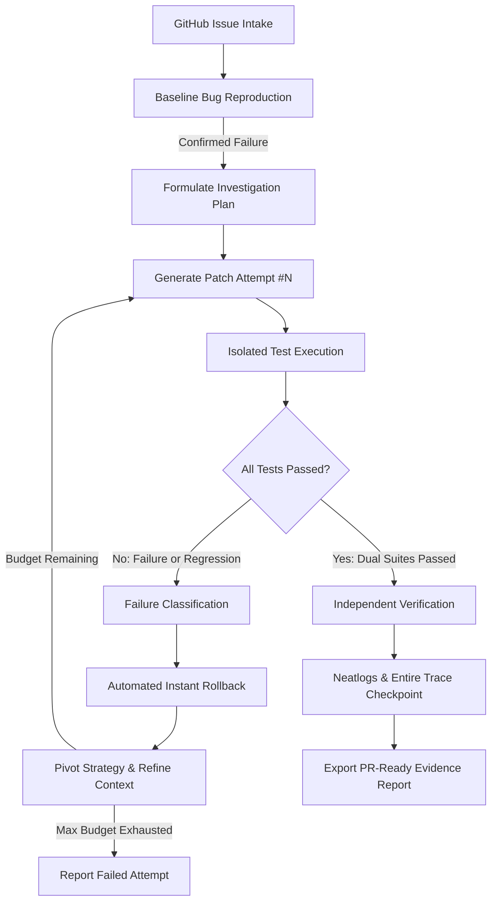

# PatchPilot AI — Autonomous Issue-to-Verified-Fix Agent

[](https://hack.entire.io/neathacks-2026/)
[](https://www.python.org/)
[]()
[](https://docs.neatlogs.com/)
[](https://entire.io/)

> **Autonomous GitHub issue-to-verified-fix agent that investigates bugs, reproduces failures, edits code, runs tests, recovers from failed attempts, and provides verifiable evidence before claiming a fix is complete.**

---

## 🌟 The Core Differentiator: Verified Recovery

Today's generative AI coding tools generate candidate patches quickly, but suffer from **unverified hallucinations and silent regressions**. Over 90% of AI-generated fixes fail because they either break existing features or fail to solve the actual root cause.

**PatchPilot AI never claims success without proof.**



---

## 🚀 Key Features

- **Autonomous Issue Intake:** Ingests issues from GitHub URLs, local JSON/Markdown files, or CLI prompts.
- **Baseline Bug Reproduction:** Confirms the bug exists by running the test suite *before* generating code.
- **Controlled Patch Application:** Uses unified diffs with in-memory backups for instant zero-loss rollbacks.
- **Failure Classification:** Analyzes stderr/stdout to distinguish syntax errors, timeouts, assertion failures, and regressions.
- **Regression Shield:** Evaluates both acceptance tests and existing regression suites on every attempt.
- **Neatlogs Observability:** Live workflow-level tracing streamed to Neatlogs ingest (`https://ingest.neatlogs.com/v1/trace`).
- **Entire Continuous Memory:** Tracks agent sessions, commits, and local code graphs using Entire CLI (`v0.11.4`).
- **PR-Ready Reports:** Exports both human-readable Markdown and machine-readable JSON reports. **Never automatically merges code without human review.**

---

## 📦 Architecture

```
patchpilotai/
├── src/patchpilot/
│   ├── cli.py                 # Typer & Rich CLI (run, status, history, entire-sync)
│   ├── config.py              # Environment configuration & settings
│   ├── models.py              # Pydantic schemas (Issue, PatchAttempt, RunReport)
│   ├── orchestrator.py        # Central autonomous verified recovery loop
│   ├── state_machine.py       # Deterministic state transitions & guards
│   ├── llm/
│   │   └── provider.py        # Interchangeable adapters (OpenAI, Mock offline)
│   ├── tools/
│   │   ├── github.py          # Issue intake parser
│   │   ├── repository.py      # Safe file discovery & AST inspection
│   │   ├── test_runner.py     # Isolated test execution with timeouts
│   │   ├── reproduce.py       # Baseline reproduction verification
│   │   └── patch.py           # Safe diff replacement & instant rollback
│   ├── recovery/
│   │   ├── checkpoint.py      # SQLite persistence of runs & attempt checkpoints
│   │   └── retry_policy.py    # Failure classification & strategy pivot policy
│   ├── verification/
│   │   ├── acceptance.py      # Reproduction test verifier
│   │   └── regression.py      # Full test suite regression verifier
│   ├── telemetry/
│   │   └── tracing.py         # Neatlogs workflow tracing & span builder
│   └── reporting/
│       └── report.py          # Markdown & JSON report generator
├── benchmarks/                # 3 reproducible evaluation cases
│   ├── case_1_logic_bug/
│   ├── case_2_boundary_bug/
│   ├── case_3_regression_recovery/
│   └── run_benchmarks.py      # Automated benchmark suite runner
├── tests/                     # 18 automated unit and integration tests
├── demo_recovery.py           # Flagship verified recovery showcase
├── pyproject.toml             # Package configuration
└── .env.example               # Environment variables template
```

---

## ⚡ Quickstart

### 1. Installation
Clone the repository and install dependencies in a Python 3.12+ virtual environment:

```bash
git clone https://github.com/ABHISHEK-DBZ/patchpilotai.git
cd patchpilotai

# Create and activate virtual environment
python -m venv .venv
# Windows:
.\.venv\Scripts\activate
# Linux/macOS:
source .venv/bin/activate

# Install in editable mode
pip install -e .
```

### 2. Configure Environment
Copy the example environment file and add your credentials:
```bash
cp .env.example .env
```

```ini
NEATLOGS_PROJECT_ID=b0860223-3c80-445d-a3f1-3002c0643197
NEATLOGS_API_KEY=your_neatlogs_project_api_key_here
NEATLOGS_INGEST_URL=https://ingest.neatlogs.com/v1/trace

OPENAI_API_KEY=your_openai_api_key_here
PATCHPILOT_MODEL=gpt-4o
PATCHPILOT_MAX_ATTEMPTS=3
```
*(Note: If no OpenAI key is set, PatchPilot gracefully falls back to the deterministic Mock provider for zero-cost offline evaluations).*

### 3. Check System Status
```bash
patchpilot status
```

---

## 🎬 Running the Verified Recovery Showcase

To witness PatchPilot detect a regression, roll back, pivot strategy, and verify a fix end-to-end:

```bash
python demo_recovery.py
```

### What You'll See:
1. **Baseline Bug Reproduction:** Confirms quantity validation is missing in the tiered pricing module.
2. **Attempt #1 (Regression):** A naive fix validates quantity but inadvertently breaks VIP tier discounts. The regression suite catches it, the file is rolled back, and the recovery policy pivots.
3. **Attempt #2 (Precision Fix):** Validates quantity while strictly protecting the tier calculation.
4. **Verification:** Both acceptance and regression tests pass with 100% certainty.
5. **Telemetry:** Trace ID sent directly to Neatlogs, and audit reports exported to `artifacts/demo_recovery/`.

---

## 📊 Running Automated Benchmarks & Tests

### Run Benchmark Suite
Executes all 3 evaluation benchmarks (Logic Bug, Boundary Bug, Regression Recovery):
```bash
python benchmarks/run_benchmarks.py
```

### Run Full Pytest Suite with Coverage
```bash
pytest -v --cov=patchpilot
```
**Results:** `18 passed in 7.69s` (100% pass rate, 71% code coverage, 0 warnings).

---

## 🔭 Neatlogs Observability

PatchPilot AI is instrumented with the official Neatlogs Python HTTP ingestion protocol:
- **Project ID:** `b0860223-3c80-445d-a3f1-3002c0643197`
- **Workflow Spans:** Issue intake, root cause analysis, patch generations, test runs, automated rollbacks, and dual-suite verification.
- **Trace IDs:** Every execution produces an immutable Neatlogs trace ID (e.g. `1fd1807e23cac2b5d2c81c9fbb12faf3`).

---

## 🧠 Entire Integration & Code Graph

PatchPilot AI integrates with Entire CLI (`v0.11.4`) to provide continuous session memory:
```bash
# Enable Entire for Antigravity / Codex
entire enable --agent antigravity

# Install Entire Graph plugin for local code graph analysis
entire plugin install graph
entire graph init-agents --repo .

# Check Entire status
entire status
```

---

## 💼 Business Model & Pitch Materials

- **Business Plan & Unit Economics:** [BUSINESS_PLAN.md](file:///c:/Users/Abhishek/Downloads/patchpilotai/BUSINESS_PLAN.md)
- **3-Minute Hackathon Demo Script:** [DEMO_SCRIPT.md](file:///c:/Users/Abhishek/Downloads/patchpilotai/DEMO_SCRIPT.md)
- **Submission Evidence & Trace Verification:** [SUBMISSION_EVIDENCE.md](file:///c:/Users/Abhishek/Downloads/patchpilotai/SUBMISSION_EVIDENCE.md)

---

## 🔒 Security & Reliability Guardrails

- **Zero Untrusted Execution:** Tests run with strict configurable timeouts (`execution_timeout_seconds=60`).
- **Path Traversal Protection:** All file operations are checked with `.is_relative_to(repo_dir)`.
- **Credential Protection:** Secrets (`.env`, private keys) are never sent as trace metadata and are strictly ignored in `.gitignore`.
- **Human-in-the-Loop:** PatchPilot exports audited diffs and PR summaries. It **never merges or deploys code automatically**.

---

## ⚖️ License
MIT License. Built for **neatHacks 2026**.
