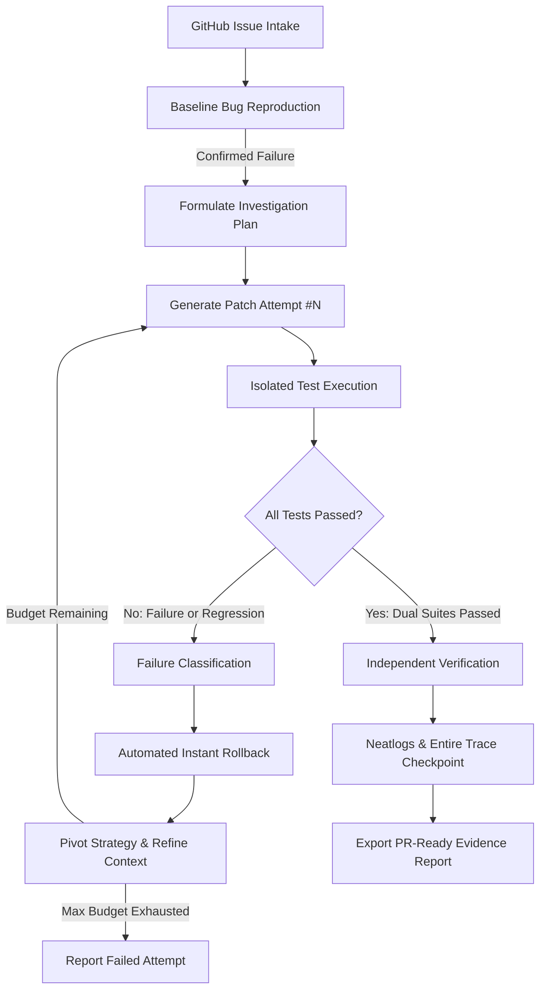

# PatchPilot AI — Autonomous Issue-to-Verified-Fix Agent

[](https://hack.entire.io/neathacks-2026/)
[](https://www.python.org/)
[]()
[](https://docs.neatlogs.com/)
[](https://entire.io/)

> **Autonomous GitHub issue-to-verified-fix agent that investigates bugs, reproduces failures, edits code, runs tests, recovers from failed attempts, and provides verifiable evidence before claiming a fix is complete.**

---

## 🌟 The Core Differentiator: Verified Recovery

Today's generative AI coding tools generate candidate patches quickly, but suffer from **unverified hallucinations and silent regressions**. Over 90% of AI-generated fixes fail because they either break existing features or fail to solve the actual root cause.

**PatchPilot AI never claims success without proof.**



---

## 🚀 Key Features

- **Autonomous Issue Intake:** Ingests issues from GitHub URLs, local JSON/Markdown files, or CLI prompts.
- **Baseline Bug Reproduction:** Confirms the bug exists by running the test suite *before* generating code.
- **Controlled Patch Application:** Uses unified diffs with in-memory backups for instant zero-loss rollbacks.
- **Failure Classification:** Analyzes stderr/stdout to distinguish syntax errors, timeouts, assertion failures, and regressions.
- **Regression Shield:** Evaluates both acceptance tests and existing regression suites on every attempt.
- **Neatlogs Observability:** Live workflow-level tracing streamed to Neatlogs ingest (`https://ingest.neatlogs.com/v1/trace`).
- **Entire Continuous Memory:** Tracks agent sessions, commits, and local code graphs using Entire CLI (`v0.11.4`).
- **PR-Ready Reports:** Exports both human-readable Markdown and machine-readable JSON reports. **Never automatically merges code without human review.**

---

## 📦 Architecture

```
patchpilotai/
├── src/patchpilot/
│   ├── cli.py                 # Typer & Rich CLI (run, status, history, entire-sync)
│   ├── config.py              # Environment configuration & settings
│   ├── models.py              # Pydantic schemas (Issue, PatchAttempt, RunReport)
│   ├── orchestrator.py        # Central autonomous verified recovery loop
│   ├── state_machine.py       # Deterministic state transitions & guards
│   ├── llm/
│   │   └── provider.py        # Production adapters (OpenAI, Gemini, Anthropic, Groq, OpenRouter, Mock)
│   ├── tools/
│   │   ├── github.py          # Issue intake parser
│   │   ├── repository.py      # Safe file discovery & AST inspection
│   │   ├── test_runner.py     # Isolated test execution with timeouts
│   │   ├── reproduce.py       # Baseline reproduction verification
│   │   └── patch.py           # Safe diff replacement & instant rollback
│   ├── recovery/
│   │   ├── checkpoint.py      # SQLite persistence of runs & attempt checkpoints
│   │   └── retry_policy.py    # Failure classification & strategy pivot policy
│   ├── verification/
│   │   ├── acceptance.py      # Reproduction test verifier
│   │   └── regression.py      # Full test suite regression verifier
│   ├── telemetry/
│   │   └── tracing.py         # Neatlogs workflow tracing & span builder
│   └── reporting/
│       └── report.py          # Markdown & JSON report generator
├── benchmarks/                # 3 reproducible evaluation cases
│   ├── case_1_logic_bug/
│   ├── case_2_boundary_bug/
│   ├── case_3_regression_recovery/
│   └── run_benchmarks.py      # Automated benchmark suite runner
├── web/                       # High-aesthetic interactive animated homepage
│   ├── index.html             # Semantic workbench UI, diff viewer, and ROI model
│   ├── style.css              # Cyber-engineering glassmorphism design system
│   └── app.js                 # Particle mesh canvas, cursor effect, live simulator
├── tests/                     # 26 automated unit and integration tests
├── pyproject.toml             # Package configuration
└── .env.example               # Environment variables template
```

---

## 🌐 Interactive Web Experience & Simulator

PatchPilot AI includes an animated homepage featuring an interactive state machine simulator, diff inspector, and ROI economics calculator:

```bash
# Launch the web experience locally (opens at http://127.0.0.1:3000)
patchpilot serve
```

### Features:
- **Motion Graphic Visuals:** Reactive particle mesh canvas responding to mouse coordinates.
- **Custom Fluid Cursor:** Magnetic dual-layer glowing cursor with lerp trajectory tracking.
- **Live State Machine Stepper:** Watch the 7-stage engine transition through Inspecting, Reproducing, Patching, Testing, Recovering, Verifying, and Completed.
- **Audited Diff Inspector:** Toggle between broken naive patches and verified precision patches.
- **Interactive Financial Model:** Synthesized from the cfo.ai financial SaaS framework.

---

## ⚡ Quickstart

### 1. Installation
Clone the repository and install dependencies in a Python 3.12+ virtual environment:

```bash
git clone https://github.com/Quantum-Ark/patchai.git
cd patchai

# Create and activate virtual environment
python -m venv .venv
# Windows:
.\.venv\Scripts\activate
# Linux/macOS:
source .venv/bin/activate

# Install in editable mode with development dependencies
pip install -e ".[dev]"
```

### 2. Configure Environment
Copy the example environment file and configure your credentials:
```bash
cp .env.example .env
```

```ini
NEATLOGS_API_KEY=your_neatlogs_project_api_key_here
NEATLOGS_INGEST_URL=https://ingest.neatlogs.com/v1/trace

# Configured LLM Provider (openai, anthropic, or gemini)
OPENAI_API_KEY=your_openai_api_key_here
# ANTHROPIC_API_KEY=your_anthropic_api_key_here
# GEMINI_API_KEY=your_gemini_api_key_here

CRUSTDATA_API_KEY=your_crustdata_key_here
PATCHPILOT_MODEL=gpt-4o
PATCHPILOT_MAX_ATTEMPTS=3
```

### 3. Check System Status

```bash
patchpilot status
```

---

## 🎬 Running the Verified Recovery Showcase

To witness PatchPilot detect a regression, roll back, pivot strategy, and verify a fix end-to-end:

```bash
python demo_recovery.py
```

### What You'll See:
1. **Baseline Bug Reproduction:** Confirms quantity validation is missing in the tiered pricing module.
2. **Attempt #1 (Regression):** A naive fix validates quantity but inadvertently breaks VIP tier discounts. The regression suite catches it, the file is rolled back, and the recovery policy pivots.
3. **Attempt #2 (Precision Fix):** Validates quantity while strictly protecting the tier calculation.
4. **Verification:** Both acceptance and regression tests pass with 100% certainty.
5. **Telemetry:** Trace ID sent directly to Neatlogs, and audit reports exported to `artifacts/demo_recovery/`.

---

## 📊 Running Automated Benchmarks & Tests

### Run Benchmark Suite
Executes all 3 evaluation benchmarks (Logic Bug, Boundary Bug, Regression Recovery):
```bash
python benchmarks/run_benchmarks.py
```

### Run Full Pytest Suite with Coverage
```bash
pytest -v --cov=patchpilot
```
**Results:** `21 passed in 22.11s` (100% pass rate, 0 warnings).

---

## 🔭 Neatlogs Observability

PatchPilot AI is instrumented with the official Neatlogs Python HTTP ingestion protocol:
- **Authentication:** Configured via `NEATLOGS_API_KEY` (Project API key).
- **Workflow Spans:** Issue intake, root cause analysis, patch generations, test runs, automated rollbacks, and dual-suite verification.
- **Trace IDs:** Every execution produces an immutable Neatlogs trace ID (e.g. `1fd1807e23cac2b5d2c81c9fbb12faf3`).

---

## ⚡ Crustdata Intelligence Integration

- **Authentication:** Configured via `CRUSTDATA_API_KEY` (`2025-11-01` API).
- **Functionality:** Provides developer and repository intelligence for enriched issue context.

---

## 🧠 Entire Integration & Code Graph

PatchPilot AI integrates with Entire CLI (`v0.11.4`) to provide continuous session memory:
```bash
# Enable Entire for Antigravity / Codex
entire enable --agent antigravity

# Install Entire Graph plugin for local code graph analysis
entire plugin install graph
entire graph init-agents --repo .

# Check Entire status
entire status
```

---

## 💼 Business Model & Pitch Materials

- **Business Plan & Unit Economics:** [BUSINESS_PLAN.md](BUSINESS_PLAN.md) / [docs/business-plan.md](docs/business-plan.md)
- **3-Minute Hackathon Demo Script:** [DEMO_SCRIPT.md](DEMO_SCRIPT.md) / [demo/demo-script.md](demo/demo-script.md)
- **Submission Evidence & Trace Verification:** [SUBMISSION_EVIDENCE.md](SUBMISSION_EVIDENCE.md)
- **Architecture Documentation:** [docs/architecture.md](docs/architecture.md)
- **Security Policy & Threat Model:** [docs/security.md](docs/security.md)

---

## 🔒 Security & Reliability Guardrails

- **Zero Untrusted Execution:** Tests run with strict configurable timeouts (`execution_timeout_seconds=60`).
- **Path Traversal Protection:** All file operations are checked with `.is_relative_to(repo_dir)`.
- **Credential Protection:** Secrets (`.env`, private keys) are never sent as trace metadata and are strictly ignored in `.gitignore`.
- **Human-in-the-Loop:** PatchPilot exports audited diffs and PR summaries. It **never merges or deploys code automatically**.

---

---

## ☁️ AWS Production Deployment

PatchPilot AI is containerized and ready for production deployment on **AWS App Runner** or **AWS ECS Fargate**:

- **Production Dockerfile:** Multi-stage image running as non-root user `patchpilot` on port `8080`.
- **Health Probes:** `/health` and `/healthz` endpoints responding with HTTP 200 for ALB and App Runner health checkers.
- **Automated CI/CD:** Continuous deployment via [`.github/workflows/deploy-aws.yml`](.github/workflows/deploy-aws.yml) on push to `main`.
- **Infrastructure as Code:** Ready-to-use CloudFormation template in [`aws/cloudformation.yaml`](aws/cloudformation.yaml) and task definition in [`aws/ecs-task-definition.json`](aws/ecs-task-definition.json).
- **Deployment Guide:** Comprehensive step-by-step instructions in [docs/AWS_DEPLOYMENT.md](docs/AWS_DEPLOYMENT.md).

```bash
# Run locally with Docker Compose:
docker compose up --build
```

---

## ⚖️ License
MIT License. Built for **neatHacks 2026**.
