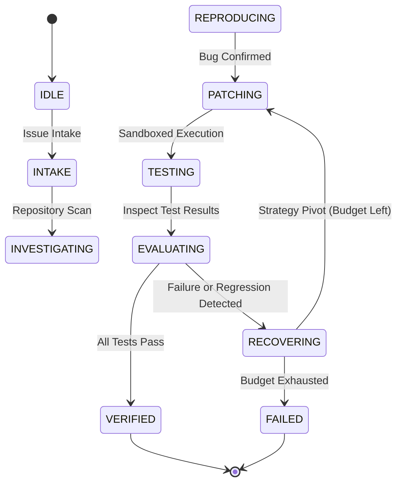

# PatchPilot AI — Architecture & Systems Design
*neatHacks 2026 Technical Specification*

---

## 1. System Overview

PatchPilot AI is an autonomous software repair agent specifically engineered around **Verified Recovery**. Rather than relying on optimistic one-shot generation, the agent follows a deterministic state machine that:
1. Ingests issues and performs AST-aware repository discovery.
2. Confirms root-cause bugs through baseline test reproduction.
3. Proposes unified diff patches with isolated filesystem backups.
4. Executes sandboxed tests with timeouts and memory limits.
5. Classifies failures (syntax error, timeout, regression, assertion failure).
6. Automatically rolls back failed changes and pivots its strategy.
7. Performs independent dual-suite verification before exporting PR-ready diffs.

---

## 2. Core Subsystems

### 2.1 State Machine & Orchestrator (`src/patchpilot/orchestrator.py`)
- **Deterministic Transitions:** Enforced by `AgentStateMachine` preventing illegal jumps.
- **Run Context:** Tracks `run_id`, baseline commit, attempt counts, test outcomes, and Neatlogs trace metadata.
- **Rollback Engine:** Guarantees atomic filesystem restoration on failed attempts via `PatchTool.rollback()`.

### 2.2 LLM Provider Layer (`src/patchpilot/llm/provider.py`)
- Interchangeable adapter pattern:
  - `OpenAIProvider`: Production model inference (`gpt-4o`).
  - `MockLLMProvider`: Deterministic offline execution for CI/CD and repeatable benchmarking.

### 2.3 Isolated Test Runner (`src/patchpilot/tools/test_runner.py`)
- Subprocess isolation with configurable timeouts (`execution_timeout_seconds=60`).
- Strict working directory binding (`cwd=self.working_dir`).
- Environment isolation with automatic `PYTHONPATH` resolution for target repository packages.

### 2.4 Recovery & Retry Policy (`src/patchpilot/recovery/retry_policy.py`)
- **Classification:** Categorizes failures into:
  - `SYNTAX_ERROR`: AST / Indentation flaws.
  - `MISSING_DEPENDENCY`: Import errors.
  - `TIMEOUT`: Execution hangs or deadline exceeded.
  - `REGRESSION_INTRODUCED`: Previous working tests broken by patch.
  - `TEST_ASSERTION_FAILURE`: Bug still present.
- **Recovery Action:** Decides whether to `ROLLBACK_AND_PIVOT`, `RETRY_WITH_NEW_STRATEGY`, or `TERMINATE_MAX_BUDGET`.

### 2.5 Observability & Governance
- **Neatlogs Tracing (`src/patchpilot/telemetry/tracing.py`):** Real-time span emission directly to Neatlogs ingestion API (`https://ingest.neatlogs.com/v1/trace`) with project ID `b0860223-3c80-445d-a3f1-3002c0643197`.
- **Entire CLI (`.entire/`):** Continuous agent session tracking, Git hook integration, and Entire Graph local code relationship indexing.
